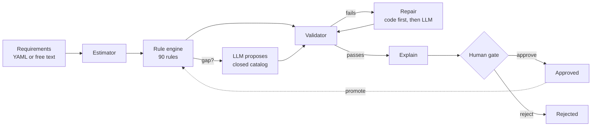

# ArchGate

**Requirements in, reviewed system design out.**
A system design generator where deterministic rules make the decisions, an LLM only fills the
gaps, and nothing ships until a human approves it.


**🚀 Live demo: [archgate.onrender.com](https://archgate.onrender.com)**
<sub>(free hosting: the first load may take ~30 seconds while the server wakes up)</sub>

```bash
$ archgate design examples/chat_app.yaml
Chat App: 20 components (20 from rules, 0 suggested by the model)
confidence: high   llm calls: 0
```

---

## Why I built this

Most "AI architect" tools ask an LLM for a design and hope for the best. The output looks
plausible, but you can't tell **why** a component is there, you get a different answer each
time, and nobody signs off on it.

I wanted to see how far I could get by doing it the other way round:

- **Code first.** Capacity math, component selection, validation and fixes are all deterministic.
- **The model is a fallback.** It runs only when no rule covers a requirement, it can only pick
  from a fixed catalog, and every suggestion goes through the same validator as everything else.
- **People approve.** Every run ends in `AWAITING_APPROVAL`, and every decision is traced back to
  the rule, check, model call or person that made it.

The same pattern (guardrailed LLM + rule engine + audit trail + human gate) applies to any
high-stakes generation problem, not just architecture.

## Highlights

| | |
|---|---|
| 🧠 **Rule engine** | 90 YAML rules across 12 areas (traffic, data, caching, reliability, security, compliance, cost…) with priority bands to settle conflicts |
| 📐 **Capacity estimator** | Peak QPS, read/write split, replicated storage and egress from plain requirements |
| ✅ **Validator + auto-repair** | Detects single points of failure, consistency mismatches, capacity and latency problems, missing dependencies; fixes what it can deterministically |
| 🤖 **Guardrailed LLM layer** | Optional local model (Ollama, `qwen2.5`). Closed catalog, can't remove rule-backed components, per-run budget on calls, retries and time |
| 🔍 **Full traceability** | Every component and setting records who decided it (`rule:CA001`, `llm`, `human`…) and why; `trace.jsonl` logs every step |
| 🚦 **Human approval gate** | Explicit state machine; blocked designs need `--force`; confidence is rated `high` / `review_needed` / `blocked` |
| 📈 **Learns from approvals** | `archgate promote` turns an approved model suggestion into a new rule, so the model isn't needed next time |
| 🌐 **Web UI** | FastAPI + Jinja + Mermaid, SVG/PNG diagram downloads, SQLite or Postgres, one-click Render deploy |
| 🧪 **Measured, not guessed** | 29-case benchmark, golden snapshot tests, 300-case property tests and a rule auditor |

## What you get

For each run ArchGate writes a design doc with requirements, capacity estimate, a Mermaid
diagram, and the reasoning behind every decision:

| Component | Decided by | Why |
|---|---|---|
| WebSocket Gateway | `rule:RT001` | Push-based updates need persistent connections and fan-out between gateway nodes. |
| Presence Service | `rule:RT003` | Chat users expect online status and typing indicators. |
| Wide-Column Store (Cassandra) | `rule:DS002`, `rule:RT004` | Eventual consistency lets you trade transactions for near-linear write and storage scale. Message history is append-heavy and read by conversation. |
| CDN | `rule:DM004` | Blobs belong in object storage served through a CDN, not in the database. |

| Setting | Value | Decided by | Why |
|---|---|---|---|
| `idempotency` | idempotency-keys | `rule:AS002` | Retries are inevitable at this volume; idempotency keys stop users getting the same push twice. |
| `backup_strategy` | daily-snapshot | `rule:BA003` | Bad deploys and accidental deletes happen; replicas copy them, backups don't. |

It also lists components that were **considered and rejected** (with the reason), and stamps the
run with a hash of the exact rules and catalog used, so any design can be reproduced later.

## How it works

```
INTAKE → ESTIMATE → RULES → (PROPOSE) → VALIDATE ⇄ REPAIR → EXPLAIN → AWAITING_APPROVAL → APPROVED / REJECTED
```



| Step | Done by | What happens |
|---|---|---|
| Intake | code, or model for free text | Requirements are parsed and validated against a strict schema |
| Estimate | code | Peak QPS, read/write split, storage, egress |
| Rules | rule engine | YAML rules pick components; priorities settle conflicts |
| Propose | model (optional) | Only runs if a required slot is empty or a feature has no rule |
| Validate | code | SPOF, consistency, capacity, latency, multi-region and catalog checks |
| Repair | code first, then model | Deterministic fixes first; the model only for what's left |
| Explain | model (optional) | Short trade-off notes; rule rationale is always included |
| Gate | human | Approve or reject with a note; blocked designs need `--force` |

### Guardrails on the model

- **Closed catalog.** The model can only choose from the 53 component ids in `data/components.yaml`.
- **No silent removals.** It can't remove rule-backed components unless a validation failure involves them.
- **Explicit states.** Only the transitions in `pipeline.TRANSITIONS` can happen.
- **Budgets.** Each run caps model calls, repair rounds and wall time. When it hits a cap it escalates to a human instead of retrying.
- **Everything is labelled.** Model suggestions are marked as such and lower the run's confidence to `review_needed`.

## Engineering decisions

A few choices I made on purpose, and the trade-offs:

- **Rules as data, not code.** Rules are YAML with a small condition language
  (`all` / `any` / `not`, `>= in contains`…). Adding a rule doesn't need a code change, and
  `archgate check-kb` fails loudly on unknown fields, components or values.
- **Priority bands for conflicts.** Compliance (90) beats correctness (80) beats reliability (70)
  beats scale (60) beats cost (50). Conflicts are settled the same way every time and can be explained.
- **Deterministic repair before model repair.** Most validation failures (e.g. "99.9% availability
  with one database") have a known fix. The model is only asked about what's left, which keeps
  runs cheap, fast and reproducible.
- **Local, free model.** Ollama with a 3B model means no API keys and no data leaving the machine.
  Everything still works with `--no-llm`.
- **Honest benchmarks.** The 29 reference designs were written alongside the rules, so 100% shows
  the rules are *consistent*, not that they're *right*. Reference cases written by someone else
  would be the real test.

## Quality and testing

```bash
uv run pytest            # 98 tests
uv run archgate bench    # passed 29/29 (100%), component recall 100%, forbidden 0, settings 100%
uv run archgate audit-rules
```

- **Benchmark:** 29 reference problems (URL shortener, ride sharing, payments wallet, healthcare
  portal, flash-sale ticketing, video platform…), each with required, forbidden and optional
  components and expected settings.
- **Golden snapshots:** CI fails if a rule change moves any benchmark design.
- **Property tests:** 300 random requirement sets checking invariants such as "exactly one primary
  database", "every dependency met", "three nines never has a single database" and determinism.
- **Rule audit:** finds dead, always-on, duplicate and contested rules.

## Quick start

```bash
git clone https://github.com/Santhoshi-K-S/arch-gate.git && cd arch-gate
uv sync

uv run archgate design examples/news_feed.yaml          # rules only if Ollama isn't running
uv run archgate show    runs/<run-id>
uv run archgate approve runs/<run-id> --note "looks good"
uv run archgate reject  runs/<run-id> --note "needs multi-region writes"
```

Turn on the model layer (free, runs locally):

```bash
ollama pull qwen2.5:3b
uv run archgate design --text "A ride-sharing app for 2M daily riders with live driver tracking"
```

Use `--model`, `ARCHGATE_MODEL` or `ARCHGATE_OLLAMA_URL` to change the model or server, and
`--no-llm` to force rules only.

### Web UI

Try it live at **[archgate.onrender.com](https://archgate.onrender.com)**, or run it locally:

```bash
uv sync --extra web
uv run archgate serve      # http://127.0.0.1:8000
```

A rules-only prototype: fill in a form (or paste YAML), get the diagram, components and
reasoning, and download SVG / PNG / Mermaid / Markdown. It has no model, no approval gate and no
login. See [WEB.md](WEB.md) for details and deploying to Render.

## Reference

<details>
<summary><b>Requirements format</b></summary>

```yaml
name: Chat App
daily_active_users: 5_000_000
requests_per_user_per_day: 60
read_write_ratio: 2          # reads per write
avg_write_kb: 1
latency_p99_ms: 200
availability: 99.9           # percent
consistency: eventual        # strong | eventual
features: [chat, notifications, media]

# optional, with defaults
retention_years: 5
peak_factor: 3
regions: 1
budget: medium               # low | medium | high
data_model: relational       # relational | document | key_value | graph | time_series
write_pattern: balanced      # balanced | append_only | update_heavy
traffic_pattern: steady      # steady | spiky | seasonal
ordering: none               # none | per_key | global
hot_keys: false
multi_tenant: false
compliance: []               # pci | hipaa | gdpr | soc2
team_size: medium            # small | medium | large
rpo_minutes: 60              # acceptable data loss
rto_minutes: 240             # acceptable downtime
```

Features with rules today: `chat`, `realtime`, `collaboration`, `feed`, `media`, `file_upload`,
`search`, `semantic_search`, `recommendations`, `payments`, `geo`, `notifications`, `analytics`,
`batch_jobs`, `public_api`, `short_links`. Any other tag goes to the model or is flagged for review.
</details>

<details>
<summary><b>Run output files</b></summary>

Each run writes to `runs/<run-id>/`:

| File | Contents |
|---|---|
| `design.md` | Design doc: requirements, estimates, Mermaid diagram, who decided each component, trade-offs |
| `design.mmd` | The diagram on its own |
| `trace.jsonl` | Every decision, in order, with its actor |
| `run.json` | Full run state, used by `approve` and `reject` |
| `requirements.yaml` | The requirements the run used; edit and rerun |
</details>

<details>
<summary><b>Writing rules</b></summary>

Rules live in `src/archgate/data/rules/`, one file per area.

```yaml
- id: CA001
  name: Cache for read-dominated traffic
  priority: 40
  when:
    all:
      - {field: read_write_ratio, op: ">=", value: 10}
      - {field: peak_read_qps, op: ">=", value: 500}
  then: {add: [cache], set: {cache_strategy: cache-aside}}
  why: Reads dominate, so caching cuts database load and latency.
```

| Band | Priority |
|---|---|
| Compliance | 90 |
| Correctness (money, inventory) | 80 |
| Reliability | 70 |
| Scale / capacity | 60 |
| Cost trims | 50 |
| Features and patterns | 40 |
| Optimizations | 30 |
| Defaults | 10-20 |

- **Fields** can be any requirement field or estimator output.
- **Operators:** `> >= < <= == != in contains`, combined with `all`, `any` and `not`.
- **Actions:** `add`, `remove` and `set`.
- After an intended rule change, refresh snapshots with
  `ARCHGATE_UPDATE_GOLDEN=1 uv run pytest tests/test_golden.py`.
</details>

<details>
<summary><b>Learning from approved runs</b></summary>

When the model fills a gap and a reviewer approves the design:

```bash
uv run archgate promote runs/<run-id>
```

This drafts a rule from the approved suggestion, shows it, and on confirmation adds it to
`learned_rules.yaml` (or `--learned-rules PATH`). From then on that feature is handled by a rule
with no model call. Learned rules are included in the knowledge-base hash.
</details>

## Project layout

```
src/archgate/
  cli.py            commands: design, show, approve, reject, promote, bench, audit-rules, check-kb, serve
  pipeline.py       state machine and run orchestration
  requirements.py   schema and parsing
  estimator.py      capacity math
  rules_engine.py   condition language, priorities, conflict resolution
  validator.py      checks and deterministic repairs
  llm.py            Ollama client
  assistant.py      model tasks; every output is schema-checked before use
  knowledge.py      loads rules + catalog, computes the knowledge-base hash
  promote.py        approved suggestion -> new rule
  benchmark.py      reference-case scoring
  audit.py          rule-base audit
  render.py         design doc and Mermaid output
  trace.py          decision log
  web/              FastAPI app, forms, storage, templates
  data/             components.yaml (catalog) and rules/*.yaml
benchmarks/cases/   29 reference designs
tests/              unit, golden, property and web tests
```

## Roadmap

1. ✅ Rule engine, estimator, validator, approval gate
2. ✅ Benchmark, golden and property tests, rule audit, versioning, rule promotion
3. ✅ Web UI with diagram export and Render deploy
4. ⏳ Train a tiny transformer from scratch on rule-generated designs
5. ⏳ Swap it in behind `LLMClient` and score it with `archgate bench`

## Development

```bash
uv run pytest
uv run ruff check .
```

## License

MIT
